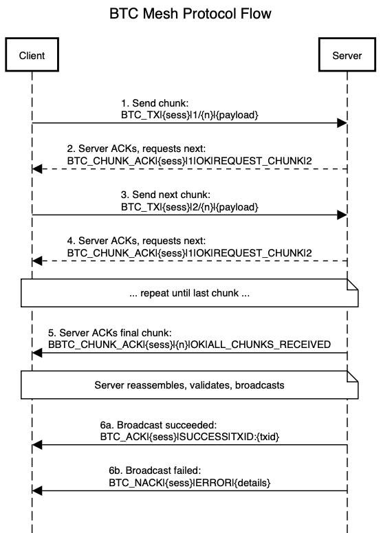

# BTCMesh Protocol Specification

Version 1.1 — August 2026

## Overview

BTCMesh uses a stop-and-wait ARQ protocol to reliably transmit Bitcoin raw transactions over LoRa Meshtastic direct messages. Transactions are chunked into small pieces that fit within LoRa payload limits, sent one at a time with acknowledgment, and reassembled by the server for broadcast to the Bitcoin network.

Chunks carry the transaction in one of two encodings, selected by the message prefix:

| Encoding | Prefix | Chars per tx byte | Tx bytes per message | Since |
|----------|--------|-------------------|----------------------|-------|
| hex | `BTC_TX` | 2.00 | 85 | 1.0 |
| base64 | `BTC_TX64` | 1.33 | 126 | 1.1 |

Both fit the same 187-character message. Because a Meshtastic text message is a fixed-size box, base64 carries ~48% more transaction per packet, and since stop-and-wait spends a full round trip per chunk, fewer chunks means proportionally less time on air.

| Transaction | hex chunks | base64 chunks |
|-------------|-----------|---------------|
| 191 B (1-in 1-out P2WPKH) | 3 | 2 |
| 222 B (1-in 2-out P2WPKH) | 3 | 2 |
| 372 B (2-in 2-out P2WPKH) | 5 | 3 |
| 600 B (multi-input) | 8 | 5 |

### Compatibility

`BTC_TX64|` does not match `BTC_TX|` (the prefix includes the pipe), so a v1.0 relay ignores base64 chunks rather than misparsing them. Servers accept both encodings; clients default to hex so that relays can be upgraded before senders. A session must not mix encodings — see `BTC_NACK` below.

## Protocol Flow



## Message Types

### 1. BTC_TX / BTC_TX64 (Client → Server)

Transaction chunk containing a fragment of the encoded raw transaction.

**Format:** `BTC_TX|<session_id>|<chunk_number>/<total_chunks>|<hex_payload>`
**Format:** `BTC_TX64|<session_id>|<chunk_number>/<total_chunks>|<base64_payload>`

| Field | Type | Description |
|-------|------|-------------|
| `session_id` | string | 5-character hex session identifier |
| `chunk_number` | integer | 1-indexed chunk number |
| `total_chunks` | integer | Total number of chunks in session |
| `hex_payload` | string | Fragment of raw transaction hex |
| `base64_payload` | string | Fragment of the base64 encoding of the raw transaction |

**Examples:**
- `BTC_TX|a1b2c|1/3|02000000000108bf2c7d...`
- `BTC_TX64|a1b2c|1/2|AgAAAAABCL8sfaXvry...`

The base64 payload is produced by encoding the **whole** transaction once and then splitting the resulting string; it is not a per-chunk encoding. The server concatenates the fragments in order and decodes once. Chunk size is a multiple of 4, so every chunk except possibly the last is also independently decodable.

### 2. BTC_CHUNK_ACK (Server → Client)

Server acknowledges receipt of a chunk and requests the next, or confirms all chunks received.

**Format (intermediate):** `BTC_CHUNK_ACK|<session_id>|<chunk_number>|OK|REQUEST_CHUNK|<next_chunk>`

**Format (final):** `BTC_CHUNK_ACK|<session_id>|<chunk_number>|OK|ALL_CHUNKS_RECEIVED`

| Field | Type | Description |
|-------|------|-------------|
| `session_id` | string | Session being acknowledged |
| `chunk_number` | integer | Chunk that was received |
| `status` | string | Always `OK` |
| `command` | string | `REQUEST_CHUNK` or `ALL_CHUNKS_RECEIVED` |
| `next_chunk` | integer | Next expected chunk (only with `REQUEST_CHUNK`) |

**Examples:**
- `BTC_CHUNK_ACK|a1b2c|1|OK|REQUEST_CHUNK|2`
- `BTC_CHUNK_ACK|a1b2c|3|OK|ALL_CHUNKS_RECEIVED`

### 3. BTC_ACK (Server → Client)

Confirms transaction was successfully broadcast to the Bitcoin network.

**Format:** `BTC_ACK|<session_id>|SUCCESS|TXID:<txid>`

| Field | Type | Description |
|-------|------|-------------|
| `session_id` | string | Session that was broadcast |
| `status` | string | Always `SUCCESS` |
| `txid` | string | Bitcoin transaction ID returned by the node |

**Example:** `BTC_ACK|a1b2c|SUCCESS|TXID:abc123def456789...`

### 4. BTC_NACK (Server → Client)

Reports an error during reassembly, validation, or broadcast.

**Format:** `BTC_NACK|<session_id>|ERROR|<error_detail>`

| Field | Type | Description |
|-------|------|-------------|
| `session_id` | string | Session that failed |
| `status` | string | Always `ERROR` |
| `error_detail` | string | Condensed error message (to make sure it fits within payload and protocol) |

**Example:** `BTC_NACK|a1b2c|ERROR|Insufficient fee`

A session whose chunks arrive under more than one prefix (`BTC_TX` and `BTC_TX64`) is discarded and NACKed rather than reassembled: concatenating hex and base64 fragments would otherwise yield a silently corrupt transaction. Base64 that fails to decode after reassembly is reported the same way.

Total NACK message length is capped at 200 characters to fit LoRa payload constraints.

## Constants

| Constant | Value | Description |
|----------|-------|-------------|
| Chunk size (hex) | 170 hex chars (85 bytes) | Maximum hex payload per chunk |
| Chunk size (base64) | 168 base64 chars (126 bytes) | Maximum base64 payload per chunk; multiple of 4. Override with `BTCMESH_CHUNK_SIZE_B64` |
| Session ID length | 5 hex chars | Random UUID-derived identifier |
| ACK timeout | 30 seconds | Client waits this long for server ACK |
| Retry timeout | 10 seconds | Client waits before retrying |
| Max retries | 3 | Maximum retry attempts per chunk |
| Reassembly timeout | 300 seconds (5 min) | Server discards incomplete sessions after this |

## Session ID

- Created by the client and send with each message
- 5-character lowercase hex string
- Generated from `uuid4().hex[:5]`
- Unique per transaction attempt
- Used to correlate chunks, ACKs, and final result across the session

Without session IDs, chunks from different transactions would be impossible to distinguish, especially in a mesh network where messages can arrive out of order or from multiple sources.

## Stop-and-Wait ARQ

The client uses a stop-and-wait Automatic Repeat Request protocol:

1. Send chunk N
2. Wait up to 30 seconds for `BTC_CHUNK_ACK` with matching session and chunk number
3. If ACK received with `REQUEST_CHUNK|N+1`: send chunk N+1
4. If ACK received with `ALL_CHUNKS_RECEIVED`: wait for final `BTC_ACK` or `BTC_NACK`
5. If no ACK received within timeout: retry (up to 3 times)
6. If max retries exceeded: abort session

## Error Condensing

The server condenses RPC error messages for LoRa size constraints. Common mappings:

| Bitcoin Core Error | Condensed |
|-------------------|-----------|
| Transaction outputs already in utxo set | TX already in UTXO set |
| Transaction already in block chain | TX already in chain |
| insufficient fee | Insufficient fee |
| missing inputs | Missing inputs |
| bad-txns-inputs-spent | Inputs spent |
| bad-txns-in-belowout | Input < Output |
| too-long-mempool-chain | Chain too long |
| mempool full | Mempool full |
| replacement transaction | RBF disabled |
| non-mandatory-script-verify-flag | Script verify failed |
| bad-txns-nonstandard-inputs | Non-std inputs |
| bad-txns-oversize | TX too large |
| dust | Dust output |
| fee is too high | Fee too high |
| absurdly-high-fee | Absurd fee |

For reassembly errors (InvalidChunkFormat, MismatchedTotalChunks, MismatchedEncoding), the error type and detail are included, truncated to fit the 200-character NACK limit.

## Chunk Sizing

Each Meshtastic text message has a payload limit of 233 bytes (`Constants.DATA_PAYLOAD_LEN`). The chunk format includes overhead:

```
BTC_TX|<5 chars>|<digits>/<digits>|<payload>
BTC_TX64|<5 chars>|<digits>/<digits>|<payload>
```

With a 5-char session ID, header overhead is 17 characters for `BTC_TX` and 19 for `BTC_TX64` at single-digit chunk counts, growing by 2 characters per extra digit in the counter.

Both encodings are sized to the same 187-character message:

| | payload chars | header | total | tx bytes carried |
|---|---|---|---|---|
| hex | 170 | 17 | 187 | 85 |
| base64 | 168 | 19 | 187 | 126 |

Transactions needing more than 9 chunks widen the counter; at 100+ chunks (≈12.6 KB of transaction) a base64 message reaches 191 characters, still 42 bytes below the radio limit.

The base64 chunk size is deliberately conservative — it matches the message length v1.0 already ships in production rather than pushing to the 233-byte cap, since PKC-encrypted direct messages consume part of the payload for the authentication tag. Set `BTCMESH_CHUNK_SIZE_B64` (a positive multiple of 4) to calibrate for a specific radio, region, or channel configuration.

## Multiple Concurrent Sessions

The server supports multiple concurrent sessions from different senders. Sessions are keyed by `(sender_node_id, session_id)`. Each session independently tracks received chunks and timeouts.
